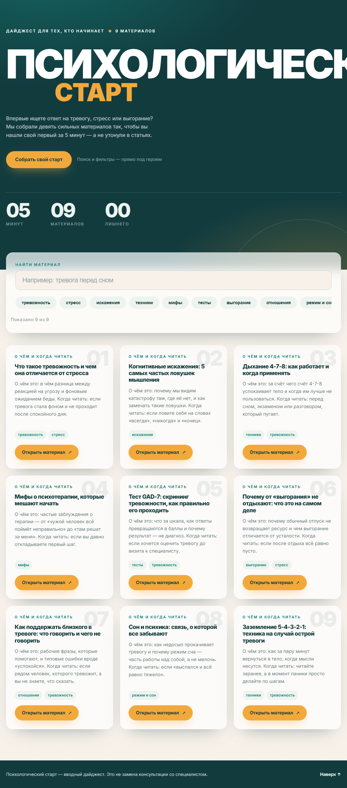
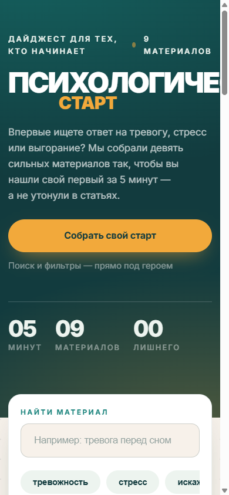

# Психологический старт — конверсионный дайджест для новичков

Сайт-дайджест на Flask. Одна задача: помочь человеку за 5 минут найти
свой первый материал про тревогу, стресс и выгорание, а не утонуть в статьях.



Тёмный hero, сетка из 9 карточек (3 → 2 → 1 колонки), живой поиск
и фильтр по тегам-чипам, янтарные CTA-кнопки. Шрифт Inter, стеклянные
поверхности, анимации с уважением к `prefers-reduced-motion`.

## Запуск

```bash
pip install -r requirements.txt
python app.py
```

Открой в браузере: http://127.0.0.1:5000

## Что внутри

| Файл | Что это |
|---|---|
| `app.py` | Flask-приложение (страница + отдача данных карточек) |
| `content.json` | Данные 9 карточек: заголовок, описание, ссылка, теги |
| `templates/index.html` | Разметка страницы |
| `static/style.css` | Стили (палитра, стекло, сетка, состояния) |
| `static/script.js` | Живой поиск, фильтр по тегам, пустое состояние |

## Возможности

- **Живой поиск** по заголовкам и описаниям — без перезагрузки страницы;
- **Фильтр по тегам** — лента чипов, клик включает/выключает фильтр;
- **Пустое состояние** — дружелюбное сообщение + кнопка «сбросить фильтры»;
- адаптивная сетка: 3 колонки → 2 → 1; без `backdrop-filter` на ширине до 768px;
- все ссылки ведут на реальные общедоступные материалы (Википедия, NHS);
- `nbsp` после предлогов и союзов во всех текстах карточек.



## Промпт

Проект создан в [OpenCode](https://opencode.ai) одним детальным промптом
(творческое задание, вариант 2). Промпт сохранён в файле
[`PROMPT.md`](PROMPT.md).